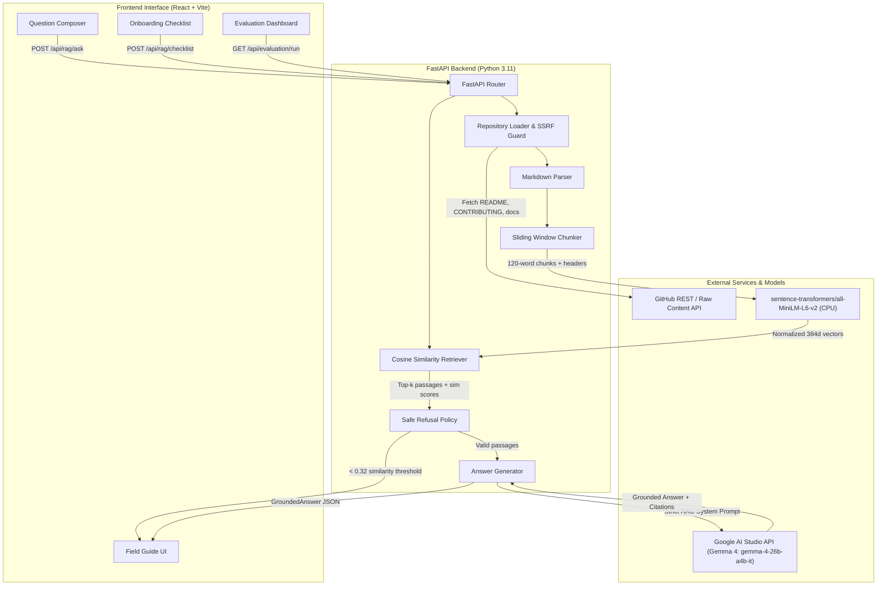
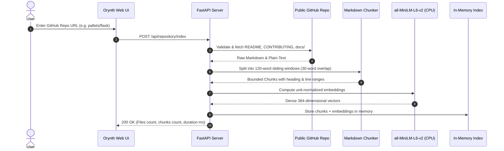
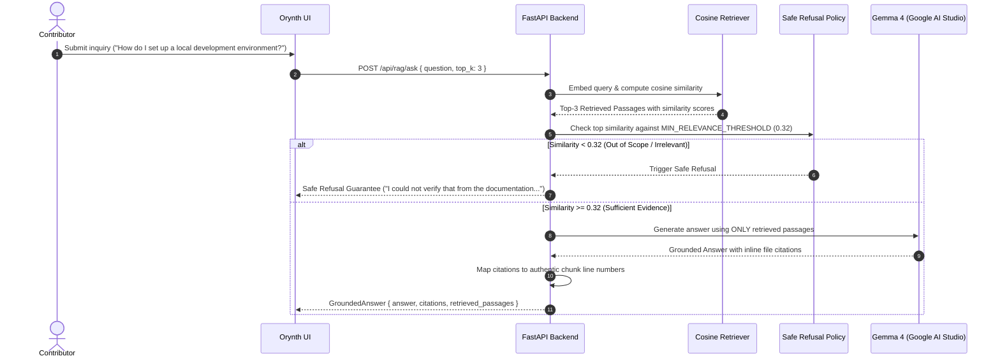

# Orynth System Architecture

**Hackathon Theme:** HacktoberFest HackDay Theme 2B: Open-Source Contributor Guide  
**Core Technologies:** Google Gemma 4 (`gemma-4-26b-a4b-it`), `all-MiniLM-L6-v2` (CPU embeddings), FastAPI, React + Vite.

---

## 1. High-Level Architecture Diagram

---

## 2. Ingestion & Chunking Flow

---

## 3. Query & Grounded Answer Flow

---

## 4. Key Design Decisions
1. **CPU Execution:** All embeddings (`all-MiniLM-L6-v2`) run locally on CPU without dedicated GPU requirements.
2. **In-Memory Vector Store:** For bounded documentation sets (up to 25 files), in-memory NumPy matrix dot-product provides sub-millisecond retrieval latency without running a bulky external vector database.
3. **Safe Two-Tier Refusal:**
   - Tier 1: Cosine similarity cutoff (< 0.32) refuses before LLM invocation.
   - Tier 2: Gemma prompt instructs exact refusal phrase when facts are missing.
4. **Verifiable Citations:** Line numbers and file paths are mapped back to actual retrieved chunks and linked directly to public GitHub files.
